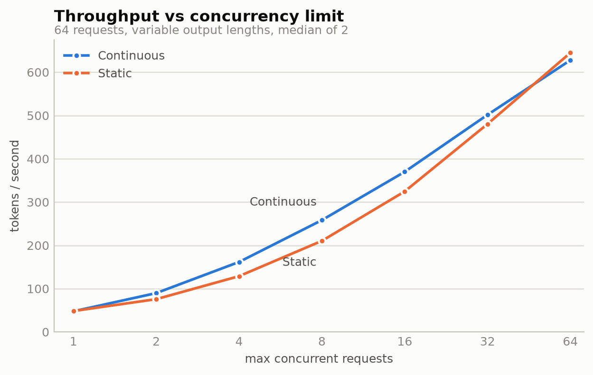

# mini-vllm

A small LLM inference server written from scratch to understand how systems like vLLM work. It has a paged KV cache, continuous batching, prefix caching, and an OpenAI-compatible streaming API, in about 1,600 lines of Python. PyTorch handles the matmuls; the memory management, scheduling, batching and streaming are my own code.

Model: Qwen2.5-0.5B-Instruct. Tested on Apple M5 (MPS) and NVIDIA T4 (CUDA).

## Overview

| File | Role |
|---|---|
| `config.py` | Parses a HuggingFace `config.json`, picks the dtype |
| `request.py` | A request: prompt, sampling params, generated tokens, status |
| `model.py` | Qwen2 decoder (RMSNorm, RoPE, GQA, SwiGLU) and weight loading |
| `cache.py` | Paged KV cache: block pool, allocator, prefix cache |
| `scheduler.py` | Continuous batching: who runs each step, who gets preempted |
| `engine.py` | The loop: schedule, batch, forward, sample |
| `sampler.py` | Batched sampling with per-request temperature, top-k, top-p |
| `detokenizer.py` | Incremental detokenization that doesn't split UTF-8 characters |
| `server.py` | FastAPI server, OpenAI-compatible, SSE streaming |

**Paged KV cache.** A sequence's KV lives in 16-token blocks scattered through a pool, and each request keeps a block table mapping logical positions to physical blocks. It is a page table applied to attention, so no request reserves a worst-case contiguous span.

**Continuous batching.** Scheduling is redone every iteration. A request that finishes frees its slot immediately, and a new arrival joins the next forward pass.

**Prefix caching.** Each full block gets a chained hash, so requests sharing a prompt prefix reuse the same blocks. The allocator's refcounts make the sharing safe.

One design rule ties these together: attention never allocates cache memory. It receives the cache and metadata as arguments, which is why the cache could move from contiguous to paged without touching `model.py`.

## Results

16 concurrency slots, fp16, every figure a median of 3 warmed runs. Reproduce with `bench/benchmark.py`.

### Latency under load

40 requests, Poisson arrivals at 8/s.

| scheduling | TTFT p50 | TTFT p99 | TPOT p50 | tokens/s |
|---|---:|---:|---:|---:|
| continuous (M5) | 25 ms | 49 ms | 28.0 ms | 208.9 |
| static (M5) | 491 ms | 1072 ms | 25.4 ms | 184.9 |
| continuous (T4) | 30 ms | 60 ms | 36.3 ms | 197.5 |
| static (T4) | 741 ms | 1273 ms | 34.0 ms | 165.6 |

Median time-to-first-token improves 19.8x on the M5 and 24.7x on the T4, because a new request joins the next forward pass instead of waiting for the running batch to drain. Per-token latency (TPOT) is slightly worse with continuous batching on both, since new prefills are interleaved with decoding. Chunked prefill is the planned fix.

### Offline throughput

64 requests, output lengths 17 to 64 tokens (mean 39).

<picture>
  <source media="(prefers-color-scheme: dark)" srcset="bench/results/throughput-dark.png">
  
</picture>

| engine | M5 tokens/s | T4 tokens/s |
|---|---:|---:|
| mini-vllm, continuous | 400.2 | 354.9 |
| mini-vllm, static | 336.6 | 281.5 |
| HuggingFace `generate()`, batched | 381.8 | 349.4 |

Continuous batching is 1.19x faster than static on the M5 and 1.26x on the T4. A static batch runs until its longest member finishes, so it spends extra forward passes (310 vs 245) on slots that have already finished.

Against HuggingFace it is a tie (1.05x and 1.02x). On raw offline throughput this engine matches the existing library; paged memory and mid-flight admission come on top. HuggingFace is capped at the same batch size, since giving one side a bigger memory budget would not be a fair comparison.

Throughput on the T4 as the concurrency limit grows:

| max concurrent | 1 | 2 | 4 | 8 | 16 | 32 | 64 |
|---|---:|---:|---:|---:|---:|---:|---:|
| continuous, tok/s | 36.3 | 68.4 | 124.7 | 207.6 | 330.7 | 452.7 | 594.0 |
| static, tok/s | 36.1 | 57.3 | 99.4 | 166.1 | 273.3 | 421.1 | 593.5 |

There is no gap at one slot (nothing to batch) or at 64 (every request fits in one wave). The gap exists in between, when requests outnumber slots, which is the normal situation for a server. The same shape appears on both devices.

### Prefix caching

8 requests sharing a 317-token system prompt.

| device | cache | cold TTFT (1st) | warm TTFT (rest) | tokens reused |
|---|---|---:|---:|---:|
| M5 | on | 103 ms | 27 ms | 2,128 |
| M5 | off | 59 ms | 45 ms | 0 |
| T4 | on | 408 ms | 30 ms | 2,128 |
| T4 | off | 35 ms | 29 ms | 0 |

On the M5, warm TTFT is 1.66x faster. On the T4 there is no latency gain (0.98x). My guess is that a 317-token prefill on a 0.5B model takes only a few milliseconds on a T4, so fixed per-step overhead dominates and skipping the prefix saves almost nothing. I have not verified this. The mechanism itself works on both devices (2,128 tokens reused, outputs identical to the uncached run). A longer prefix or a larger model should show the benefit, but this benchmark doesn't test that.

The 408 ms cold request on the T4 is probably one-time CUDA warmup landing on whichever run came first. I haven't isolated it.

### Limits of these numbers

Paged attention is not faster per step than a contiguous cache. Gathering blocks in PyTorch copies K/V every step where a fused kernel would read them in place. Paging buys more concurrent sequences per GB of memory, not raw speed.

### Measurement notes

An earlier version of this README reported 6.6x over "static batching". That baseline never actually batched: it blocked admission whenever anything was running, so it degenerated into one request at a time. Static batching now fills a wave up to the concurrency limit, seals it, and drains it before admitting more, which is what HuggingFace does. The honest offline number was 1.19x.

Two other measurement problems are worth recording. Throughput varied by almost 2x between runs until the benchmarks were warmed up, and TTFT p50 varied by more than 10x between a cold and a warm run. Everything above is a median of warmed trials, and the harness prints the spread.

### A bug the CUDA run found

`dtype="auto"` selected bfloat16 on the T4, and `test_accelerator_batch_invariance` failed: the same request produced different greedy tokens alone versus in a batch. `torch.cuda.is_bf16_supported()` returns `True` on Turing because it counts software emulation, but the T4 has no hardware bf16. The model was running in a slow, coarse emulated bf16, where batch-dependent rounding flipped near-tied argmaxes. Forcing fp16 or fp32 passed. The fix checks compute capability (8.0 or higher for bf16, otherwise fp16) and has unit tests for Turing, Ampere and non-CUDA devices. The M5 could never have caught this.

## Quick start

```bash
uv venv --python 3.12 && source .venv/bin/activate
uv pip install -e ".[dev,serving]"
python -m mini_vllm.server --model Qwen/Qwen2.5-0.5B-Instruct --dtype float16
```

Open <http://127.0.0.1:8000> for the demo UI: streaming chat on the left, live scheduler state on the right (running and waiting requests, KV utilisation, preemptions, prefix-cache hits, throughput). The "fire 8 concurrent" button sends eight requests at once; they share forward passes and finish at about 4.5x the throughput of the same work run one at a time (109.6 vs 24.5 tok/s on the M5).

Any OpenAI client works:

```python
from openai import OpenAI

client = OpenAI(base_url="http://127.0.0.1:8000/v1", api_key="unused")
stream = client.chat.completions.create(
    model="Qwen/Qwen2.5-0.5B-Instruct",
    messages=[{"role": "user", "content": "Explain paging in one sentence."}],
    stream=True,
)
for chunk in stream:
    print(chunk.choices[0].delta.content or "", end="", flush=True)
```

The engine can also be driven directly. `step()` runs one forward pass and advances every live request:

```python
from mini_vllm import LLMEngine, SamplingParams

engine = LLMEngine("Qwen/Qwen2.5-0.5B-Instruct")
engine.add_request("a", engine.encode("Name a colour."), SamplingParams(max_tokens=32))
engine.add_request("b", engine.encode("Name a fruit."), SamplingParams(max_tokens=32))

while engine.has_unfinished_requests():
    for out in engine.step():
        print(out.request_id, out.new_token_ids, out.finished)
```

`GET /stats` returns live scheduler state.

## Running on a GPU

[`bench/kaggle.ipynb`](bench/kaggle.ipynb) runs the full test suite and benchmarks on Kaggle (Accelerator: GPU T4 x2) or Colab, including logit parity against HuggingFace on CUDA. Both free tiers are Turing (sm_75), which is why attention is implemented directly rather than relying on FlashAttention-2 (Ampere or newer).

## Tests

```bash
pytest            # 53 fast tests: allocator, scheduler, sampler, detokenizer, dtype policy
pytest -m slow    # 28 more against real weights (~1GB download on first run)
```

All 81 pass on the T4. The most important ones:

| Test | Protects |
|---|---|
| `test_greedy_output_is_independent_of_batching` | Batching never changes a request's output |
| `test_output_survives_preemption` | A preempted and recomputed request ends on identical tokens |
| `test_prefix_cache_does_not_change_output` | Reusing a cached prefix matches recomputing it |
| `test_prefill_logits_match_hf` | fp32 logits match HuggingFace |
| `test_greedy_decode_matches_hf` | 32 greedy tokens match HuggingFace exactly |
| `test_eviction_skips_blocks_a_request_still_holds` | Eviction never frees memory a live sequence uses |
| `test_stop_string_straddling_a_token_boundary` | Stop strings spanning two tokens are still caught |

## Limitations and roadmap

Not implemented yet:

- **Fused paged-attention kernel (Triton).** The block gather is the main remaining overhead. FlashAttention-2 isn't an option on a T4, so this needs a custom kernel. Planned.
- **Chunked prefill.** A long prompt stalls decoding for a step. The attention path already supports it (`start_pos > 0`), but the scheduler doesn't use it yet. Planned.
- **Tensor parallelism.** Single-GPU only. Planned.
- **CUDA graphs.** Would cut launch overhead at small batch sizes, but needs static input buffers.
- **Batched prefill.** One prefill per step.
- **Swap-to-CPU.** Preempted requests are recomputed rather than swapped, which is less code and often cheaper than a PCIe round trip.
- **Speculative decoding and quantisation.**

## Design notes

[DESIGN.md](DESIGN.md) covers the internals and the problems I ran into, including why `generate(do_sample=False)` isn't greedy decoding and why paged decode can't be bit-identical to a contiguous cache.
